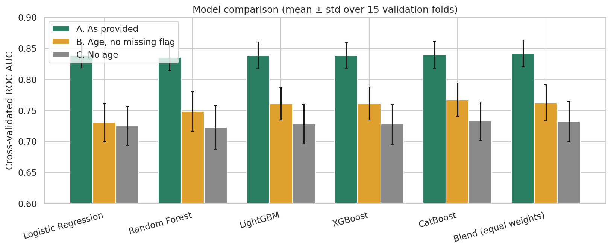
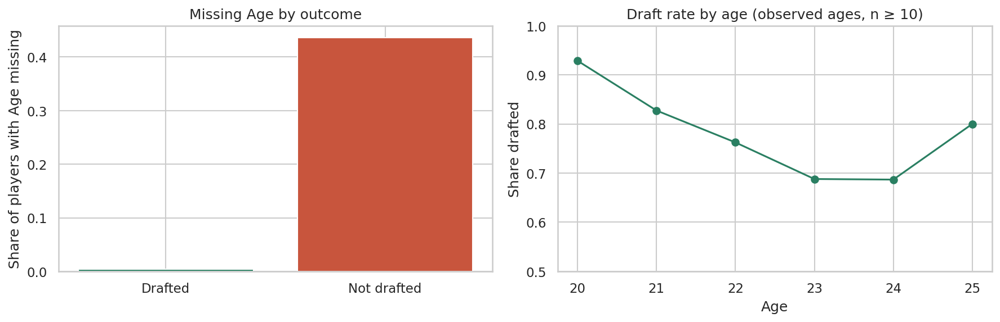

# NFL Draft Prediction

Predicting whether a college football player gets drafted into the NFL from his body measurements, combine results, position, school and age.

The project covers the full workflow: data audit, exploratory analysis, leak-free feature engineering, model comparison with repeated cross-validation, diagnostics and final predictions.

## Results

Five model families (logistic regression, random forest, LightGBM, XGBoost, CatBoost) and their equal-weight average were evaluated with 5-fold stratified cross-validation repeated 3 times (ROC AUC, mean over 15 folds).

| Scenario | Best single model | Equal-weight blend |
|---|---|---|
| **A.** All data as provided (age + "age missing" flag) | 0.840 (CatBoost) | **0.842** |
| **B.** Age value kept, "age missing" flag removed | 0.767 (CatBoost) | **0.762** |
| **C.** No age information | 0.732 (CatBoost) | **0.732** |



### The main finding: a data-collection artifact

`Age` is missing for 44% of undrafted players but only 0.4% of drafted players. The "age is missing" flag alone scores 0.72 AUC, so it behaves like a proxy for the label rather than a measure of athletic ability. It would not exist before a real draft. Scores that use it (scenario A) are therefore inflated, and **scenario B (~0.76 AUC) is the more realistic estimate** of how well a player's profile predicts his draft outcome. Both are reported throughout.



### Other takeaways

* Roughly 65% of players are drafted; kickers, punters and long snappers are rarely drafted.
* Engineered features help only a little (at most ~0.005 AUC per feature group in an ablation). Age information and position drive most of the signal.
* With the age flag, a regularised logistic regression matches gradient boosting; without it, boosted trees are about 0.03 AUC better.
* Predicted probabilities are reasonably well calibrated (see `figures/07_roc_and_calibration.png`).

## Project structure

```
nfl-draft-prediction/
├── nfl_draft_prediction.ipynb   # full analysis, run top to bottom
├── src/
│   └── features.py              # leak-free FeatureBuilder (scikit-learn style)
├── data/
│   └── README.md                # which files to place here (data is not included)
├── figures/                     # plots produced by the notebook
├── outputs/
│   └── cv_results.csv           # cross-validation scores per scenario and model
├── requirements.txt
└── README.md
```

## Getting started

The dataset is not included in this repository (see [`data/README.md`](data/README.md)). The executed notebook, figures and `outputs/cv_results.csv` are included, so you can read all results on GitHub without running anything.

To run it yourself, put `train.csv` and `test.csv` in the `data/` folder.

**Locally**

```bash
git clone https://github.com/<your-username>/nfl-draft-prediction.git
cd nfl-draft-prediction
python -m venv .venv && source .venv/bin/activate   # Windows: .venv\Scripts\activate
pip install -r requirements.txt
jupyter notebook nfl_draft_prediction.ipynb
```

**Google Colab**

1. Open `nfl_draft_prediction.ipynb` from GitHub (*File → Open notebook → GitHub*).
2. Add a first cell and run `!git clone https://github.com/<your-username>/nfl-draft-prediction.git`.
3. Upload `train.csv` and `test.csv` into `nfl-draft-prediction/data/` using the Files panel, then *Run all*. Missing packages are installed automatically.

**Anywhere else**

The notebook has no hard-coded paths. It finds the project by searching the working directory, its parents and its sub-folders for `src/features.py`. Two optional environment variables override this: `NFL_PROJECT_DIR` (project folder) and `NFL_DATA_DIR` (folder containing the CSV files).

A full run takes roughly 2–3 minutes on a standard laptop CPU. It regenerates everything in `figures/` and `outputs/` (including `outputs/predictions.csv`). All random seeds are fixed, so results are reproducible.

## Method

* **Leak-free pipeline.** `FeatureBuilder` learns every statistic (position medians for imputation, per-position means and standard deviations, school target encoding) from the training fold only and applies it unchanged to validation and test rows. School target encoding is computed out-of-fold inside the training data.
* **Features (up to 55).** Position-median imputation, missing-test count, BMI, speed score (the standard NFL formula), jump "burst", agility sum, strength per kg, z-scores of each drill against the player's position, an overall athletic composite, school draft rate and size, and one-hot position encodings.
* **Validation.** The feature builder is re-fitted inside every fold. Models use moderate regularisation rather than heavy tuning, to avoid overfitting 2,781 rows, and are blended with equal weights rather than hand-picked weights.
* **Diagnostics.** ROC and calibration curves, within-position-group AUC, gain-based feature importance and a feature-group ablation.

## Data

| Column | Description | Unit |
|---|---|---|
| `Id` | Player identifier | – |
| `Year` | Year of the record | 2009–2019 |
| `Age` | Player age (partly missing, see above) | years |
| `School` | College | – |
| `Height`, `Weight` | Body measurements | m, kg |
| `Sprint_40yd` | 40-yard dash | seconds (lower is better) |
| `Vertical_Jump`, `Broad_Jump` | Jump distances | cm |
| `Bench_Press_Reps` | Bench-press repetitions | count |
| `Agility_3cone`, `Shuttle` | Agility drills | seconds (lower is better) |
| `Player_Type`, `Position_Type`, `Position` | Role at three levels of detail | – |
| `Drafted` | Target (1 = drafted, 0 = not drafted); absent in `test.csv` | – |

Units were inferred from the value ranges. `test.csv` has no labels, so model evaluation is done by cross-validation on `train.csv`, and `test.csv` is only scored to produce `outputs/predictions.csv` (one probability column per scenario A and B). The dataset was provided to me through a data science bootcamp and is not redistributed in this repository.

## Limitations and next steps

* Draft decisions depend on things not in the data (college production, injuries, team needs), so a ceiling well below perfect accuracy is expected.
* Evaluation uses random splits; a time-based split (train on earlier years, validate on later ones) would be a stricter test.
* Possible extensions: position-specific models, probability calibration of the final blend, SHAP explanations for individual players.

## License

Released under the MIT License (see `LICENSE`).
